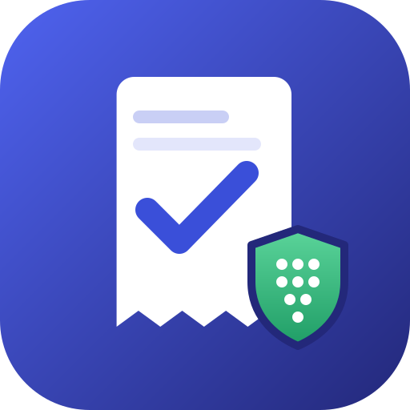
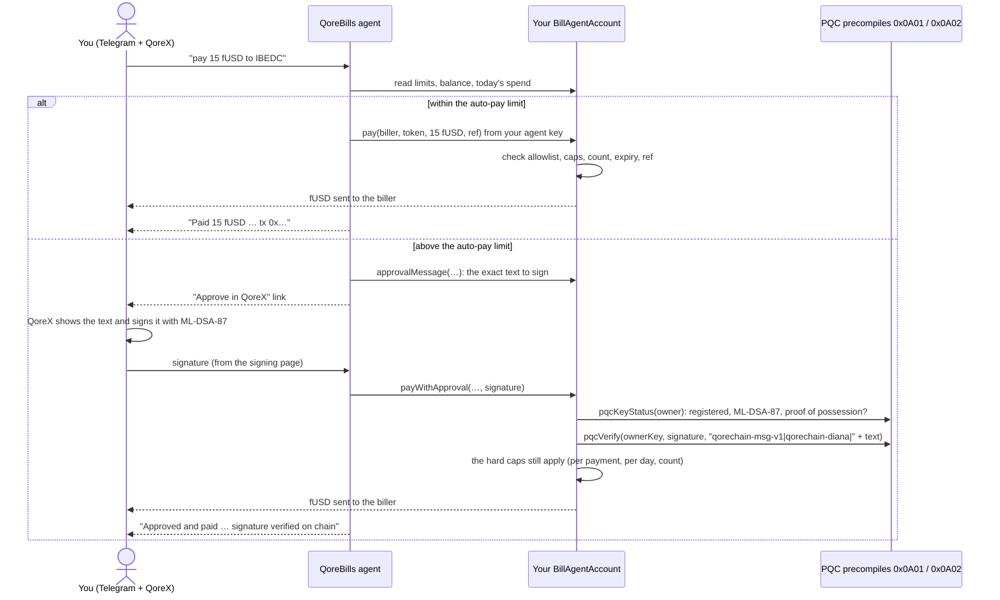
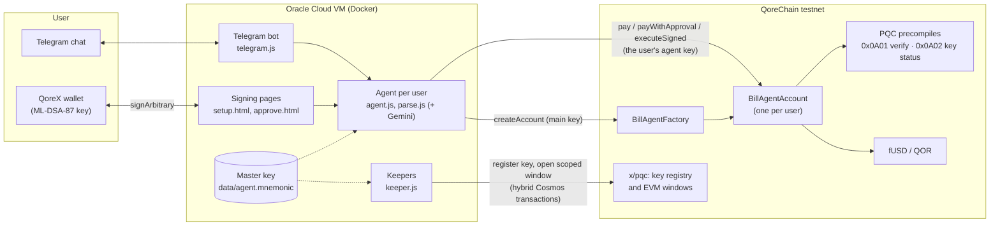

<p align="center">
  
</p>

<h1 align="center">QoreBills</h1>

**An AI agent that pays your bills from a smart account on QoreChain, where the spending limits are enforced by the chain, not by the AI, and every big decision needs your post-quantum signature.**

Built for [Build Before Q-Day](https://build.qorechain.io), **Post-Quantum AI Agents** track. `#BuildBeforeQDay`

| | |
|---|---|
| Try it | [@QoreBills_bot](https://t.me/QoreBills_bot) on Telegram + the QoreX wallet on testnet ([how](#try-it-in-5-minutes)) |
| Network | QoreChain testnet `qorechain-diana`, EVM chain id `9800` |
| Factory | [`0xF0385815a19009FBC01ba24773469c5e4e4e9b2D`](#testnet-deployment) |
| Tests | 35 contract tests and 27 agent tests (including two-user end-to-end runs), on every push in [CI](.github/workflows/ci.yml) |
| Docs | [Architecture](docs/ARCHITECTURE.md) · [Security model](docs/SECURITY.md) · [Signed messages](docs/SIGNED_MESSAGES.md) · [AI usage](AI_USAGE.md) |
| Licence | MIT |

---

## Contents

1. [The problem](#the-problem)
2. [What QoreBills does](#what-qorebills-does)
3. [Try it in 5 minutes](#try-it-in-5-minutes)
4. [How a payment works](#how-a-payment-works)
5. [Track requirements and QoreChain features](#track-requirements-and-qorechain-features)
6. [Architecture](#architecture)
7. [Smart contracts](#smart-contracts)
8. [The agent](#the-agent)
9. [Security model](#security-model)
10. [Testnet deployment](#testnet-deployment)
11. [Run it yourself](#run-it-yourself)
12. [Repository layout](#repository-layout)
13. [Limitations and what's next](#limitations-and-whats-next)
14. [Credits](#credits)

---

## The problem

Paying the same bills every month (electricity, water, rent, data, school fees) is exactly the kind of chore people want an AI agent to take over. But handing an agent a wallet today means trusting it with everything in it:

- **An agent can be wrong.** It can misread "pay 15" as "pay 150", or pay the wrong address.
- **An agent can be hijacked.** A prompt injection, a leaked API key or a hacked server gives an attacker the agent's key, and with it the money.
- **The usual fix doesn't last.** Asking the user to confirm every payment removes the point of an agent, and the ECDSA signatures used for those confirmations today will not survive a large quantum computer ("Q-Day"): an approval scheme built on them could be forged then.

The question is: **how do you let an AI act for you without trusting the AI, its server, or classical cryptography?**

## What QoreBills does

QoreBills splits the job between three parties, so that no single one of them can cause harm on its own:

| Who | Does | Cannot |
|---|---|---|
| **You**, with your QoreX wallet | Choose billers and limits once, approve big payments, pause, revoke or withdraw at any time. Each of these is a message you sign with your **ML-DSA-87** (post-quantum) key. | (You are the owner.) |
| **The AI agent**, on Telegram | Understands requests ("pay my light bill, 15 fUSD"), pays small bills on its own, asks for your signature when a bill is above your auto-pay limit, reports balances and history. | Pay anyone you haven't allowed, go over your limits, act after its permission expires, change any setting, or withdraw. |
| **Your smart account** on QoreChain | Holds the money and checks every payment against your limits and your post-quantum signature, using QoreChain's PQC precompiles. | Be talked out of a rule: the rules are code. |

The result for the user: **"pay my electricity" just happens, and nothing big happens without you.** Even if the agent's server were fully compromised, the worst an attacker could do is pay *your own* billers, within *your own* caps, until *your* expiry date, and you can stop it with one signature.

### Product features

- **Chat-first:** everything happens in a Telegram chat. Billers can be named loosely ("pay 15 to ibedc"), and with a Gemini key the agent also understands free-form requests.
- **One-signature onboarding:** a mobile setup page opens inside the QoreX app; you pick billers and limits and sign once. The agent pays the gas; you never need an EVM window or gas of your own.
- **Auto-pay below your limit, approval above it:** small bills go through in seconds; bigger ones send you an "Approve in QoreX" button that shows exactly what you are signing.
- **Never pay a bill twice:** each bill reference (by default biller + month) can be paid once.
- **Full control from the chat:** `pause`, `resume`, `add biller`, `remove biller`, `limits`, `payments per day`, `renew`, `revoke`, `withdraw`, each as a post-quantum signed message.
- **Readable signatures:** QoreX shows you plain text ("amount: 60 fUSD"), not hex.
- **Multi-user:** anyone can use the bot; each user gets their own account and their own agent key.

## Try it in 5 minutes

You need the **QoreX** wallet (mobile app or browser extension) on **testnet**, with your post-quantum key registered in QoreX, and some test QOR from the QoreChain testnet faucet.

1. Open **[@QoreBills_bot](https://t.me/QoreBills_bot)** and send `/start`.
2. Tap **Set up in QoreX**. The page opens in the QoreX browser with two **demo billers** already chosen (Electricity and Water; more in the list: Internet data, TV subscription, Hostel rent, School fees, or "Other address…" for your own). The demo billers are test addresses run by QoreBills, so test payments are not lost. The default limits work as they are (QOR: auto-pay 1, max 2 per bill, 5 a day; fUSD: 20, 100, 150; 5 payments a day; 30 days). Tap **Review and sign in QoreX**.
3. QoreX shows the full setup text; sign it. The bot replies with your new account address.
4. From QoreX → Send, send the account some **QOR** to the `qor1…` address the bot gives you (send `fund` to see it again).
5. In the chat, try:

```text
pay 0.5 QOR to electricity             → paid on its own, with the transaction hash
pay 0.5 QOR to electricity             → refused: that bill is already paid this month
pay 1.5 QOR to water ref RENT          → "Approve in QoreX": sign, and it is paid
pay 50 QOR to electricity              → refused: above the most it can pay at once
pay 1 QOR to netflix                   → refused: not on your allowlist
status · billers · history
pause → sign in QoreX → status shows PAUSED → resume
```

## How a payment works



Settings changes (`pause`, `add biller`, `limits`, `withdraw`, …) follow the second path: the agent prepares the change, the contract renders it as text, you sign it in QoreX, and the contract verifies the signature before applying it.

## Track requirements and QoreChain features

The AI Agents track asks for *"an autonomous agent with spending and access limits enforced on chain"*, with a scoped EVM window, transaction, value, duration and target limits, smart-account spending rules and authenticated messaging. Where each one is in the code:

| Requirement | How QoreBills meets it | Code |
|---|---|---|
| **Target limits** | Only owner-allowlisted billers can be paid | `_checkPayment` in [`BillAgentAccount.sol`](contracts/contracts/BillAgentAccount.sol) |
| **Value limits** | Per token: auto-pay limit, hard cap per payment, cap per UTC day (approved payments included) | `TokenLimits`, `_checkPayment` |
| **Transaction limits** | Maximum number of payments per UTC day | `maxPaymentsPerDay`, `paymentsOnDay` |
| **Duration limits** | The agent key stops working at `agentExpiry`; `pause` and `revoke` at any time | `agentExpiry`, `ActionKind.Pause`, `ActionKind.SetAgent` |
| **Smart-account spending rules** | The money sits in a per-user smart account whose rules only the owner sets | `BillAgentAccount`, `BillAgentFactory` |
| **Scoped EVM window** | Each user's agent key keeps a QoreChain EVM authorisation window open whose `allowed_targets` is **only that user's account** (the main key's: only the factory), renewed automatically | [`keeper.js`](agent/src/keeper.js), [`qorechain.js`](agent/src/qorechain.js) |
| **Authenticated messaging** | Approvals, settings changes and the account setup are QoreSign message-signing-v1 messages, checked on chain against the owner's registered ML-DSA-87 key, bound to the account, chain, deadline and nonce | [`OwnerSigned.sol`](contracts/contracts/OwnerSigned.sol), [docs/SIGNED_MESSAGES.md](docs/SIGNED_MESSAGES.md) |

QoreChain network features used:

| Feature | Used for |
|---|---|
| **Solidity PQC signature check** (PQC Verify, `0x…0A01`) | Verifying the owner's ML-DSA-87 signature on approvals, settings changes and account setup |
| **Solidity PQC key status** (PQC Key Status, `0x…0A02`) | Reading the owner's registered key and requiring ML-DSA-87 **and** proof of possession |
| **PQC key registration with proof of possession** | Every agent key (and the deployer) registers its ML-DSA-87 key with a proof of possession before it acts |
| **Hybrid ML-DSA-87 transactions** | Agent keys open and renew their EVM windows with hybrid (secp256k1 + ML-DSA-87) Cosmos transactions |
| **EVM window, scoped** | A user's agent key can only call that user's account |
| **Test tokens** | Bills are paid in **fUSD** (`0x97143B771D34ddb9130b807b135Ae675A5a963CA`, 6 decimals) or native QOR |
| **QoreX wallet message signing** | `signArbitrary` (QoreSign message signing v1) for every owner signature |

## Architecture



- **Keys:** the agent creates one master mnemonic on the server on first start (file mode 600; it never leaves the machine). Key 0 is the **main key**: it submits account setups to the factory and funds user keys with gas. Key *n* is **user n's agent key**: the only key that user's account accepts as its agent, with its own registered ML-DSA-87 key and its own scoped EVM window.
- **Why a key per user:** isolation (a user's agent key can only call that user's account) and a QoreChain limit (a window lists at most 16 targets, so one shared key could not serve many users).

More detail on state, nonces, gas and failure handling: **[docs/ARCHITECTURE.md](docs/ARCHITECTURE.md)**.

## Smart contracts

Solidity 0.8.24, `evmVersion: paris`, OpenZeppelin 5.0.2. Source in [`contracts/contracts`](contracts/contracts).

| Contract | Role |
|---|---|
| [`BillAgentAccount`](contracts/contracts/BillAgentAccount.sol) | One per user. Holds the funds, enforces the limits, pays billers (`pay`, `payWithApproval`), applies owner changes (`execute` by transaction, `executeSigned` by signed message) and renders the text the owner signs (`approvalMessage`, `actionMessage`). |
| [`BillAgentFactory`](contracts/contracts/BillAgentFactory.sol) | Creates an account from the owner's signed setup (`createAccount`), renders the setup text (`setupMessage`) and records `accountOf[owner]` and `isAccount`. Each setup id works once. |
| `BillAgentDeployer` | Holds the account's creation code so the factory stays under the 24 KB contract size limit; only the factory can call it. |
| [`OwnerSigned`](contracts/contracts/OwnerSigned.sol) | Shared base: `_verifyOwner` (deadline, message length, key status with proof of possession, `pqcVerify`), amount formatting with each token's decimals and symbol, name checks. |
| [`BillTypes`](contracts/contracts/BillTypes.sol) | `AccountConfig`, `TokenConfig`, `BillerConfig`, `OwnerAction` and its nine kinds. |

**Payment rules** (`_checkPayment`), in order: the caller is the agent → not paused → before expiry → biller allowed → token enabled → amount above zero → reference unused → amount ≤ max per payment → today's spend + amount ≤ daily cap → today's count < payments per day. `pay` also requires amount ≤ auto-pay limit; `payWithApproval` instead requires the owner's signature. The per-payment and daily caps apply **even with approval**.

**Owner actions** (`OwnerAction.kind`): `SetBiller`, `RemoveBiller`, `SetLimits`, `DisableToken`, `SetAgent` (renew or revoke), `SetMaxPaymentsPerDay`, `Pause`, `Unpause`, `Withdraw`.

**Gas:** `pay` ≈ 141k; `payWithApproval` ≈ 394k measured locally with a mock signature, plus the real ML-DSA-87 check and its 4,627-byte signature on the testnet; `createAccount` ≈ 4.9M; factory deploy 5,919,188 (testnet).

## The agent

Node.js 22 (ES modules), [viem](https://viem.sh) for EVM calls, [`@qorechain/sdk`](https://www.npmjs.com/package/@qorechain/sdk) 0.14 for keys, PQC registration, hybrid transactions and EVM windows. No web framework: `node:http` serves the signing pages, and Telegram is read by long polling, so the server needs no webhook.

| Module | Job |
|---|---|
| [`bot.js`](agent/src/bot.js) | Multi-user orchestration: one session per Telegram user with their key, agent and keeper; gas top-ups from the main key; caps on accounts and setups |
| [`agent.js`](agent/src/agent.js) | One user's conversation: pay, approve, settings, setup. Pre-checks the limits so the user gets a clear answer, and turns contract errors into sentences |
| [`parse.js`](agent/src/parse.js), [`llm.js`](agent/src/llm.js) | Deterministic command parser, and an optional Gemini parser for free-form requests. The model only **proposes** a command, which is validated like typed input and enforced again by the contract |
| [`chain.js`](agent/src/chain.js) | Contract reads and writes with fixed gas limits, custom-error decoding, one transaction at a time per key |
| [`qorechain.js`](agent/src/qorechain.js) | Master key file, PQC key registration with proof of possession, EVM windows, QOR transfers (hybrid Cosmos transactions) |
| [`keeper.js`](agent/src/keeper.js) | Keeps each key funded, registered and inside a scoped window, and renews the window before it runs out |
| [`web.js`](agent/src/web.js), [`public/`](agent/public) | Setup and signing pages for the QoreX in-app browser, and the `signArbitrary` helper |
| [`telegram.js`](agent/src/telegram.js) | Telegram Bot API client: private chats only, per-user rate limit |

Chat commands:

| Command | What happens |
|---|---|
| `pay 15 fUSD to IBEDC electricity [ref INV-1]` | Pays at once within the auto-pay limit, otherwise sends an approval link |
| `status` · `fund` · `billers` · `history` | Limits, balances, today's spend and count, expiry · the `qor1` address to send QOR to from QoreX · allowed billers · recent payments |
| `pause` · `resume` · `revoke` · `renew 30` | Signed in QoreX |
| `add biller Campus hostel 0x…` · `remove biller water` | Signed in QoreX |
| `limits fUSD 20 100 150` · `limits QOR off` · `payments per day 5` | Signed in QoreX |
| `withdraw 10 fUSD to 0x…` | Signed in QoreX |
| `setup` · `cancel` · `help` | New account · drop the pending signature request · help |

## Security model

The full threat model is in **[docs/SECURITY.md](docs/SECURITY.md)**. In short:

- **The agent's key is not trusted.** The contract bounds it by biller, amount, count and time; it can never withdraw or change a rule. A user's agent key can only send transactions to that user's account (scoped EVM window).
- **The owner is authenticated post-quantum.** Every owner instruction is an ML-DSA-87 signature verified on chain against the key QoreChain has registered for the owner, and only if that key was registered **with a proof of possession**.
- **Signatures are bound and single-use.** The signed text names the account, the EVM chain id, a deadline and a nonce; the wallet adds the Cosmos chain id and the `qorechain-msg-v1` domain. A signature is valid once, for exactly what it says.
- **Fail closed.** If the precompile were inactive (it then answers with empty data), the typed call reverts, so nothing above the auto-pay limit can be paid.
- **Input hygiene.** Biller names are printable ASCII only (no line breaks that could fake a line in the signed text); amounts with more decimals than the token has are refused instead of rounded; request bodies are size-limited.

## Testnet deployment

QoreChain testnet `qorechain-diana`, EVM chain id `9800`, deployed 23 November 2026.

| Contract | EVM address | Native address |
| --- | --- | --- |
| `BillAgentFactory` | `0xF0385815a19009FBC01ba24773469c5e4e4e9b2D` | `qor17qu9s9dpjqylhsqm5frhx35ute8yaxedecfxqh` |
| `BillAgentDeployer` | `0x06C4E1194deb3c3BbE91022fc4507b6BF5023114` | `qor1qmzwzx2dav7rh053qghug5rmd06syvg5hhmme2` |

- Deploy transaction `0x05bd2652e47accc97f24ea6d13939ba1fc7d95a33fd1933a703fd0f44b2ab016` (5,919,188 gas).
- The deployer registered its ML-DSA-87 key with a proof of possession, deployed inside a short unscoped EVM window (contract creation needs one), then closed the window.
- Users' accounts are created by the factory and listed in its `AccountCreated` events.
- Checked on the testnet: an ML-DSA-87 signature over `qorechain-msg-v1|qorechain-diana|` + an approval text verifies with `pqcVerify` at `0x…0A01`, and a changed message does not.

**Note for other builders:** the public testnet RPC caps `eth_call` and `eth_estimateGas` at about 5M gas, while a transaction may use up to 30M. The factory deploy and `createAccount` therefore set their gas limits instead of estimating them.

## Run it yourself

Requirements: Node.js 22. The tests run offline against a local Hardhat node; the Solidity compiler comes from npm, so nothing else is downloaded.

```bash
# Contracts: compile and run the 35 tests
cd contracts && npm install && npm test

# Agent: unit tests and end-to-end runs (one user and two users) on a local Hardhat node,
# with a mock of the PQC precompiles installed at 0x…0A01 and 0x…0A02
cd ../agent && npm install && npm test
```

Run your own agent on the testnet:

```bash
cd agent
cp .env.example .env    # TELEGRAM_BOT_TOKEN, PUBLIC_URL (HTTPS, reachable from phones), FACTORY_ADDRESS
npm start               # creates data/agent.mnemonic and logs the main key's address
# send about 20 test QOR to that address; the agent registers its key and opens its window
```

Deploy your own factory: `node agent/scripts/deploy-factory.js <mnemonic-file>` registers the deployer's key, opens a short window, deploys and closes the window.

Production: [`docker-compose.yml`](docker-compose.yml) runs the agent (256 MB memory cap) behind Caddy for HTTPS; [`.github/workflows/deploy.yml`](.github/workflows/deploy.yml) tests every push, writes `.env` from repository secrets over SSH and redeploys.

## Repository layout

```text
contracts/                 Solidity contracts and Hardhat tests
  contracts/               BillAgentAccount, BillAgentFactory, OwnerSigned, BillTypes, IQorePQC
  contracts/test/          MockQorePQC (precompile stand-in), MockERC20
  test/                    35 tests: limits, approvals, signed settings, factory setup
agent/                     The agent service
  src/                     bot, agent, parser, chain, QoreChain keys and windows, keeper, web, Telegram
  public/                  setup.html, approve.html, qorex.js (QoreX signArbitrary)
  scripts/deploy-factory.js
  test/                    27 tests: parser, keeper, end to end with one and two users
docs/                      Architecture, security model, signed message formats
deploy/update.sh           Server-side deploy (Docker, swap, health check)
.github/workflows/         CI (both test suites) and deploy to the Oracle VM
AI_USAGE.md                How AI was used to build QoreBills, and inside it
```

## Limitations and what's next

- **Testnet only.** The PQC precompiles and EVM windows are active on the `qorechain-diana` testnet; QoreChain's docs list the precompiles as not yet active on mainnet.
- **Billers are addresses.** Real bill payment (electricity tokens, airtime) needs a biller-side integration that turns an on-chain payment into a delivered service; the contract's `ref` field exists for that.
- **The hosted agent holds the agent keys.** That is by design, since the keys are bounded on chain, but a self-hosted mode where a user names their own agent key at setup is a natural next step.
- **Recurring schedules** ("pay rent on the 1st") are the next product feature; the contract already supports them through per-bill references and daily caps.
- **QoreChain's native spending rules** (`x/abstractaccount` authenticators) are an alternative to the contract's own limits. QoreBills keeps the rules in Solidity so they live in one place and can be read by anyone from the contract.

## Credits

QoreChain kits and services:

- [`@qorechain/sdk`](https://www.npmjs.com/package/@qorechain/sdk) 0.14: unified accounts, ML-DSA-87 key derivation and proof of possession, hybrid transaction signing, EVM windows, address conversion
- QoreChain **PQC precompiles** (PQC Verify `0x…0A01`, PQC Key Status `0x…0A02`) and their [documentation](https://docs.qorechain.io/developer-guide/evm-precompiles)
- **QoreX** wallet: `signArbitrary` (QoreSign message signing v1)
- The QoreChain testnet RPC, REST API and faucet, and the Fest test token **fUSD**

Other open-source software: [viem](https://viem.sh), [Hardhat](https://hardhat.org), [OpenZeppelin Contracts](https://openzeppelin.com/contracts) 5.0.2, [solc-js](https://github.com/ethereum/solc-js), [CosmJS](https://github.com/cosmos/cosmjs), Node.js, Docker, Caddy.

How AI was used to build QoreBills, and inside it: **[AI_USAGE.md](AI_USAGE.md)**.

## Licence

[MIT](LICENSE) © 2026 Adebanjo Abraham
