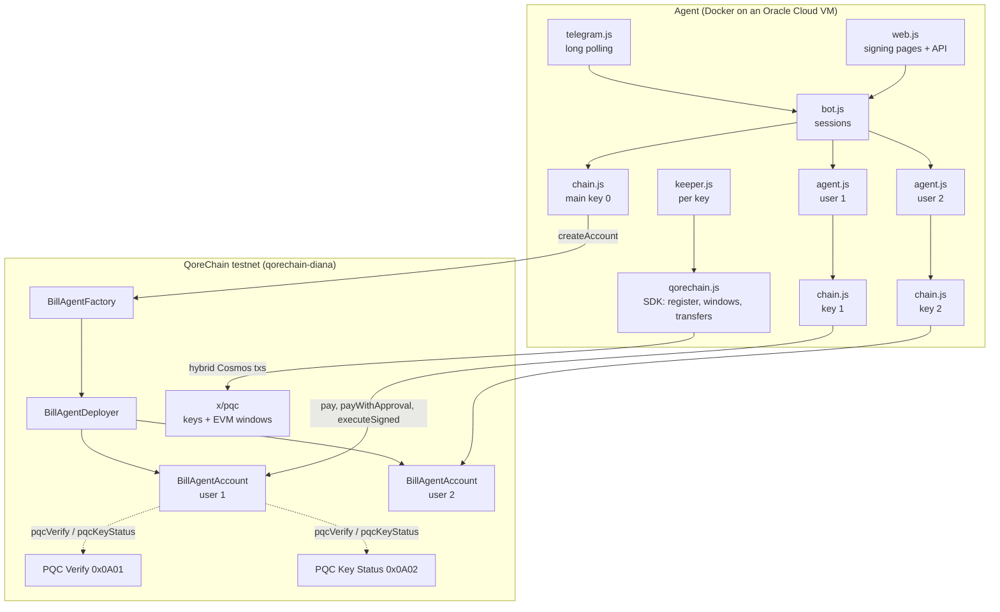
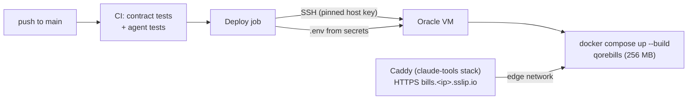

# Architecture

QoreBills has two halves: Solidity contracts on the QoreChain EVM lane, and a Node.js agent that talks to users on Telegram and to QoreChain on both lanes (EVM for the contracts, Native for key registration and EVM windows).



## Keys

The agent has one **master mnemonic**, created on first start in `AGENT_KEY_FILE` (default `data/agent.mnemonic`, mode 600, in a Docker volume). Keys are QoreChain **unified accounts** (`deriveUnifiedAccount(mnemonic, index)`): one `eth_secp256k1` key whose `qor1…` and `0x…` addresses are the same 20 bytes, with an ML-DSA-87 key derived from the address and mnemonic.

| Index | Role | Registered PQC key | EVM window `allowed_targets` | Gas |
|---|---|---|---|---|
| 0 | **Main key**: sends `createAccount` for every user; funds user keys | yes (proof of possession) | the factory | Funded by the operator; the admin is told on Telegram below 3 QOR |
| *n* ≥ 1 | **User n's agent key**: the `agent` of that user's account | yes (proof of possession) | that user's account only | 1 QOR from the main key when it drops below 0.3 QOR |

A user's index is assigned the first time they message the bot and stored in the state file. Deriving a key costs nothing; it is only funded after the user's account exists.

## State

`STATE_FILE` (default `data/state.json`) holds what must survive a restart:

```json
{
  "nextIndex": 3,
  "users": {
    "<telegram user id>": { "index": 1, "account": "0x…", "owner": "0x…", "setups": 1 }
  }
}
```

Everything else is read from the chain when needed: limits, balances, billers, nonce, payments (from `BillPaid` events). Signature requests (pending approvals, settings and setups) are kept in memory and expire after 30 minutes; a restart simply drops them.

## Flows

### First start

1. Create or read the master mnemonic and derive the main key; log its address.
2. The main keeper checks its balance and, below 3 QOR, tells the admin on Telegram where to send test QOR.
3. Once funded: register the main key's ML-DSA-87 key with a proof of possession (`MsgRegisterPQCKeyV2`, classical-signed: the one transaction allowed without a hybrid signature), then open an EVM window scoped to the factory (hybrid-signed).
4. Resume every user who already has an account, and their keepers.

### Setup

1. `/start` or `setup` → the agent creates a setup request and sends a link to `/setup/<id>`.
2. The page asks QoreX for the user's address (`getKey`) and posts the form with that address to `/api/requests/<id>/draft`.
3. The agent validates the form (billers, names, addresses, limits, decimals, payments per day, days) and builds an `AccountConfig` whose `agent` is **user n's key**. It then asks the factory for `setupMessage(owner, config, setupId, deadline)`.
4. The page has QoreX sign that text (`signArbitrary`) and posts the signature to `/api/requests/<id>/sign`.
5. The main key sends `createAccount(owner, config, setupId, deadline, signature)` with a fixed 7.5M gas limit. The factory verifies the signature and deploys the account through `BillAgentDeployer`.
6. The user's keeper runs: the main key sends 1 QOR to the user's key, which registers its ML-DSA-87 key and opens an EVM window scoped to the new account. Only then does the bot say "Your bill account is ready".

### Paying

1. The message is parsed (deterministic parser first; Gemini for free-form text if configured).
2. The agent resolves the biller among the account's allowed billers and parses the amount in the token's decimals (refusing extra decimals). It then pre-checks token enabled, reference unused, max per payment, today's remaining cap and balance, so the user gets a clear answer without spending gas.
3. Within the auto-pay limit: `pay(...)` from the user's key. Above it: a signature request (see below), then `payWithApproval(...)`.
4. Every write is simulated first, so a refusal comes back as the contract's custom error and is explained in plain words.

### Signature requests (approvals and settings)

- The agent reads the account's `nonce`, sets a deadline 30 minutes ahead and gets the exact text from `approvalMessage` or `actionMessage`.
- Only one request per user is bound to the current nonce. A newer one marks the older one `replaced`, and `cancel` drops it.
- On submission the agent checks that the nonce has not moved (`stale` otherwise), then sends the transaction. A wrong signature leaves the request open, so the user can sign again with the right account.
- Statuses: `draft` (setup before its form is in), `pending`, `submitting`, `done`, `failed`, `replaced`, `cancelled`, `stale`, `expired`.

### Keeping keys usable

Every 10 minutes, and right after a setup, each keeper:

1. tops the key up (user keys) or alerts the admin (main key) when gas is low;
2. registers the key's ML-DSA-87 key if it is not registered;
3. reopens the EVM window when it is not live, has fewer than 1,500 blocks, 20 transactions or 2 QOR of value left, or when its targets differ from what the key needs. The window is opened at QoreChain's maximum of 17,280 blocks (about 6 hours on the testnet), 1,000 transactions and 20 QOR.

A live window is closed and reopened in the same transaction.

## Concurrency and nonces

A unified account's Cosmos sequence **is** its EVM nonce, so a key's EVM calls and its Cosmos transactions (registration, windows, transfers) must not overlap. Each key has one lock (`createLock` in `qorechain.js`) shared by `chain.js` and the keeper; the main key's transfers to user keys take the main key's lock. Different users' keys work in parallel, and Telegram messages from different users are handled concurrently.

## Gas

The public testnet RPC caps `eth_call` and `eth_estimateGas` at about 5M gas, so the agent never relies on estimates:

| Call | Gas limit | Measured |
|---|---|---|
| `pay` | 400,000 | ≈ 141,000 |
| `payWithApproval` | 1,000,000 | ≈ 394,000 locally (mock signature) plus the ML-DSA-87 check and the 4,627-byte signature |
| `executeSigned` | 1,000,000 | similar to `payWithApproval` |
| `createAccount` | 7,500,000 | ≈ 4.9M with 12 billers and 2 tokens |
| Factory deploy | 7,000,000 | 5,919,188 (testnet) |

If a simulation fails only because it hit the RPC's gas cap, the transaction is sent anyway with its fixed limit; a real refusal would still revert on chain.

## Signing pages

- `GET /setup/<id>` and `GET /approve/<id>`: static pages built for the QoreX in-app browser (mobile first, light and dark), with `no-store`, `no-referrer` and `X-Frame-Options: DENY`.
- `GET /api/requests/<id>`: the request as the page shows it (kind, status, summary, exact text, expected owner address, expiry).
- `POST /api/requests/<id>/draft` (setup only) and `POST /api/requests/<id>/sign`: JSON bodies of at most 64 KB.
- `public/qorex.js` waits for `window.qorex.native`, checks the `signArbitrary` capability, refuses to sign when QoreX is open on a different account than the expected owner, and returns the wallet's answer; the agent uses its `pq.signature`.

## Deployment



- **CI** ([`ci.yml`](../.github/workflows/ci.yml)) runs both test suites on every push and pull request.
- **Deploy** ([`deploy.yml`](../.github/workflows/deploy.yml)) runs after CI on pushes that touch the agent. It skips with a notice until its secrets are set, writes `.env` over SSH (so secrets never sit in the repository or the logs), checks out the commit on the VM and runs [`deploy/update.sh`](../deploy/update.sh). That script creates the shared `edge` network and 1 GB of swap if missing, rebuilds and waits for the container's health check.
- **HTTPS:** the VM's existing Caddy server proxies `bills.<DOMAIN>` to the `qorebills` container over the shared `edge` Docker network, with an automatic certificate.

## Configuration

| Variable | Default | Meaning |
|---|---|---|
| `TELEGRAM_BOT_TOKEN` | required | From @BotFather |
| `PUBLIC_URL` | required | HTTPS address of the signing pages |
| `FACTORY_ADDRESS` | required | `BillAgentFactory` |
| `ADMIN_TELEGRAM_ID` | none | Told when the main key needs gas |
| `MAX_USERS` | 50 | Accounts the hosted demo will create |
| `GEMINI_API_KEY`, `GEMINI_MODEL` | none, `gemini-2.5-flash` | Free-form request parsing |
| `AGENT_KEY_FILE`, `STATE_FILE` | `data/agent.mnemonic`, `data/state.json` | Key and state files |
| `QORE_EVM_RPC`, `QORE_REST`, `QORE_RPC` | testnet endpoints | QoreChain endpoints |
| `EVM_CHAIN_ID`, `COSMOS_CHAIN_ID` | `9800`, `qorechain-diana` | Chains |
| `APPROVAL_MINUTES` | 30 | How long a signature request stays open |
| `TOKENS` | QOR and fUSD | JSON list of `{ symbol, address, decimals }` |

## Testing

| Suite | What it covers |
|---|---|
| `contracts/test/BillAgentAccount.test.js` | Setup, every limit, approvals (wrong details, replay, expiry, missing proof of possession, wrong key, hard caps, inactive precompile), every signed settings change, direct owner actions |
| `contracts/test/BillAgentFactory.test.js` | Exact setup text, creation by any submitter, changed or reused or expired or foreign setups, the deployer guard, size limits |
| `agent/test/parse.test.js` | Commands, biller matching, default references, wallet signature parsing |
| `agent/test/keeper.test.js` | Gas top-ups, registration, scoped windows, renewal |
| `agent/test/e2e.test.js` | One user against a local Hardhat node: setup, payments, approvals, every settings command, request replacement, revoke |
| `agent/test/bot.e2e.test.js` | Two users: separate accounts and agent keys, separate payments, one user's wallet cannot approve the other's payment, user cap, restart |

The PQC precompiles are replaced in tests by `MockQorePQC`, installed at `0x…0A01` and `0x…0A02` with `hardhat_setCode`; it accepts `keccak256(pubkey ‖ message)` as a signature. The real ML-DSA-87 path was checked separately on the testnet: an SDK-generated ML-DSA-87 signature over a QoreBills approval text in the `qorechain-msg-v1` format verifies with `pqcVerify`, and a changed message does not.
